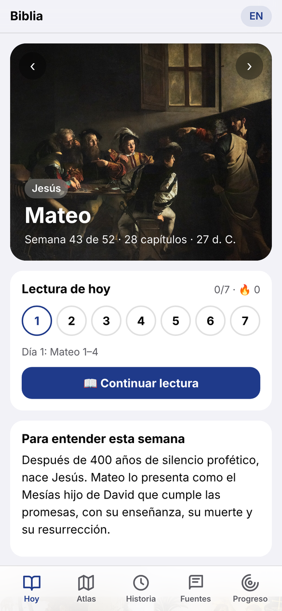
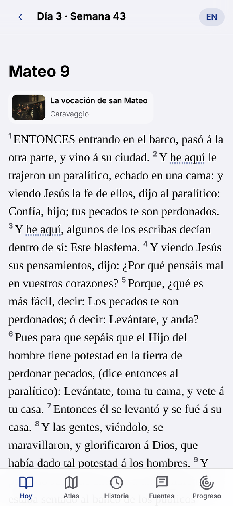
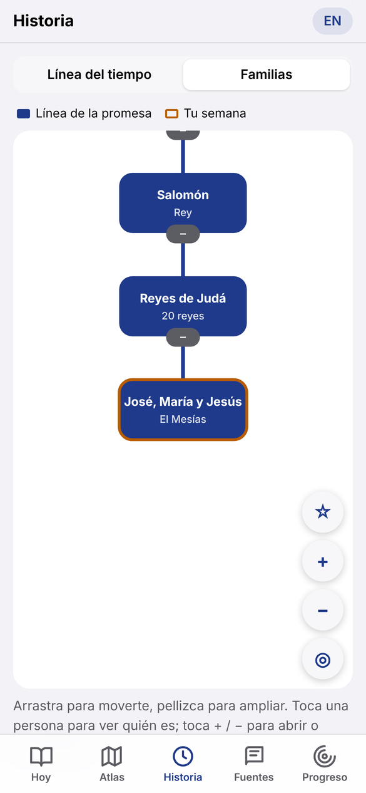
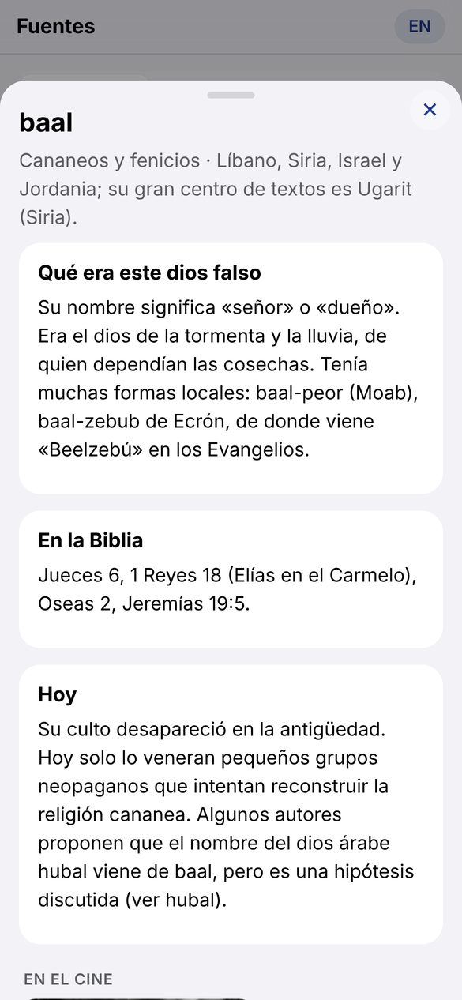
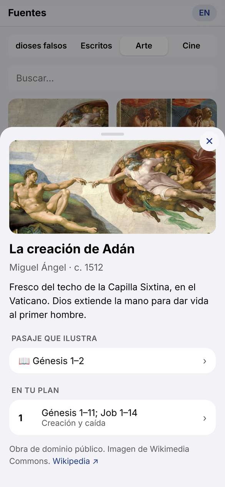

<p align="center">
  <a href="https://biblia-7s8.pages.dev"></a>
</p>

<p align="center">
  <a href="https://biblia-7s8.pages.dev"><b>Abrir la app →</b></a> ·
  <a href="#cómo-instalarla">Instalar en tu teléfono</a> ·
  <a href="#english">English</a>
</p>

<p align="center">
  
  
  
  
</p>

---

**Biblia** es una compañera de lectura para leer la Biblia completa en un año, **en el orden en que ocurrieron los hechos**. Mientras lees, te muestra dónde quedan hoy los lugares, quién es quién en cada familia, qué pasaba en el mundo en esos años, qué dioses falsos adoraban los pueblos vecinos, y cómo los grandes artistas y el cine mudo imaginaron cada escena.

Es gratuita, sin anuncios, sin cuentas y sin rastreo: tu progreso se guarda solo en tu teléfono.

## Lo que trae

<table>
<tr>
<td width="25%"></td>
<td width="25%"></td>
<td width="25%"></td>
<td width="25%"></td>
</tr>
<tr>
<td valign="top"><b>Plan de 52 semanas</b><br>Siete lecturas por semana en orden cronológico, con racha y avance.</td>
<td valign="top"><b>Lector</b><br>Reina-Valera 1909. Toca una palabra antigua para ver qué significa; resalta, copia y comparte versículos.</td>
<td valign="top"><b>Árbol genealógico</b><br>De Adán a Jesús, con la línea de la promesa resaltada. Se mueve, se amplía y abre ramas.</td>
<td valign="top"><b>Línea del tiempo</b><br>Reyes, profetas e imperios. Desliza y ve quién gobernaba en cada año.</td>
</tr>
<tr>
<td width="25%"></td>
<td width="25%"></td>
<td width="25%"></td>
<td width="25%"></td>
</tr>
<tr>
<td valign="top"><b>Atlas</b><br>Mapa satelital con cada lugar y lo que es hoy: Ur está en Irak, Edom en Jordania.</td>
<td valign="top"><b>dioses falsos</b><br>baal, moloc, asera, quemós, hubal y más: qué eran, dónde se adoraban y qué dice la Biblia.</td>
<td valign="top"><b>Arte</b><br>60 obras de dominio público —Leonardo, Miguel Ángel, Caravaggio, Rembrandt— ligadas a su pasaje.</td>
<td valign="top"><b>Cine mudo</b><br>20 escenas de películas de dominio público, como <i>Cabiria</i> (1914) y <i>El Rey de reyes</i> (1927).</td>
</tr>
</table>

**Y además:**

- **Mismo evento, varios libros.** Cuando lees un relato que la Biblia cuenta más de una vez (la caída de Jerusalén, la última cena, la conversión de Pablo), te avisa dónde más aparece para comparar.
- **Otros escritos antiguos.** Enoc, los Rollos del Mar Muerto, Josefo, la Epopeya de Gilgamesh y 40 textos más, con su relación con tu lectura y por qué no están en el canon.
- **Regiones de hoy.** Cada semana te dice a qué países actuales corresponden los lugares que lees.
- **Español e inglés**, con un solo toque.
- **Funciona sin internet** con lo que ya abriste, y se instala como una app.

## Cómo instalarla

No necesitas tienda de apps.

- **iPhone o iPad:** abre [biblia-7s8.pages.dev](https://biblia-7s8.pages.dev) en Safari → toca **Compartir** → **Agregar a pantalla de inicio**.
- **Android:** ábrela en Chrome → menú **⋮** → **Instalar app**.
- **Computadora:** solo ábrela en el navegador.

## Fuentes y derechos

| Contenido | Fuente | Licencia |
|---|---|---|
| Texto bíblico (español) | Reina-Valera 1909 | Dominio público |
| Texto bíblico (inglés) | Berean Standard Bible | Dominio público |
| Obras de arte | Wikimedia Commons | Dominio público; fotos de esculturas con crédito al fotógrafo según su licencia CC |
| Películas | Internet Archive | Dominio público |
| Mapas | Esri World Imagery | Con atribución |
| Artículos | Wikipedia | CC BY-SA |

Las fechas son aproximadas. Las películas son interpretaciones artísticas y pueden añadir o cambiar detalles del texto bíblico.

## Para desarrolladores

Es un sitio estático: HTML, CSS y JavaScript sin compilar, más [Leaflet](https://leafletjs.com) para el mapa. No hay servidor ni base de datos.

```
index.html, app.css, app.js   la app
sw.js, manifest.webmanifest   modo sin internet e instalación
data/                         contenido (es/en) y texto bíblico por libro
img/  clips/  vendor/         íconos, escenas y Leaflet
```

Para probarla en tu computadora: `python3 -m http.server` dentro de la carpeta y abre `http://localhost:8000`.

Se publica sola en Cloudflare Pages con cada cambio a `main`.

---

## English

**Biblia** is a free companion for reading the whole Bible in a year, **in the order events happened**. As you read, it shows where places are today, who's who in each family tree, what else was happening in the world, which false gods the neighboring peoples worshiped, and how great artists and silent films imagined each scene.

No ads, no accounts, no tracking — your progress stays on your device. Switch to English with the **EN** button.

**[Open the app →](https://biblia-7s8.pages.dev)** · On iPhone: Safari → Share → *Add to Home Screen*. On Android: Chrome → ⋮ → *Install app*.

Bible text: Reina-Valera 1909 (Spanish) and Berean Standard Bible (English), both public domain.
