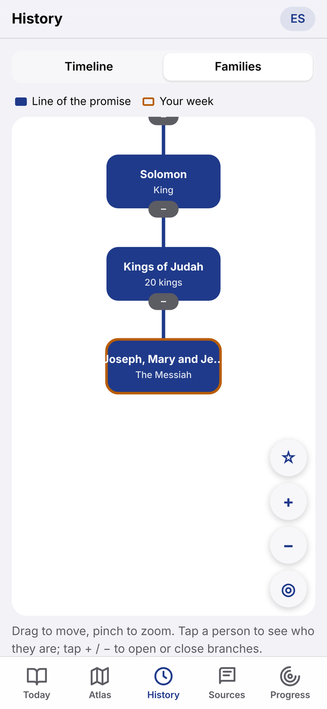
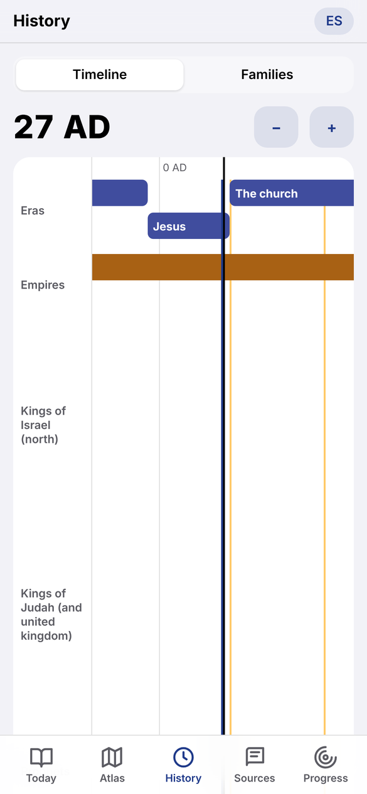
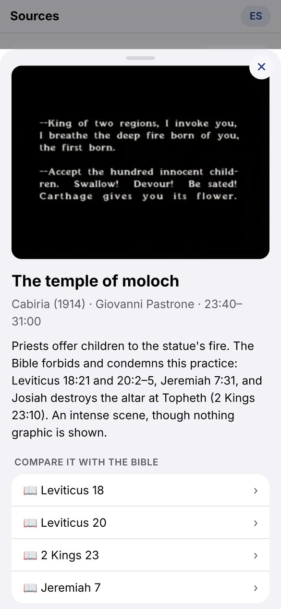
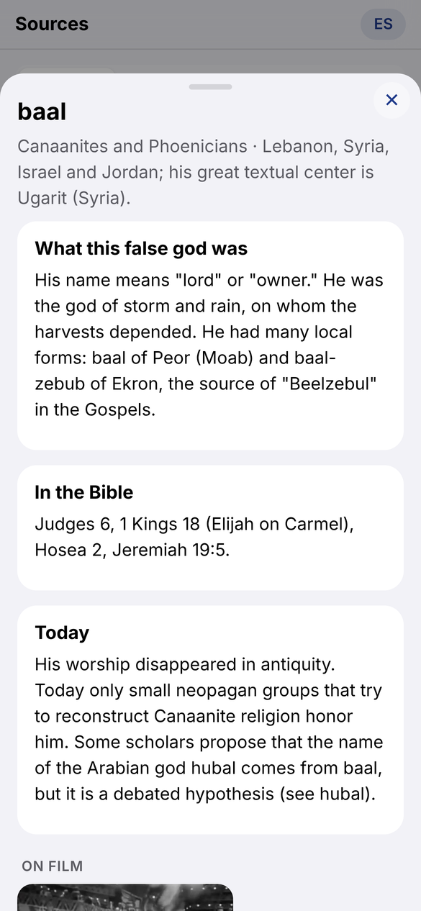
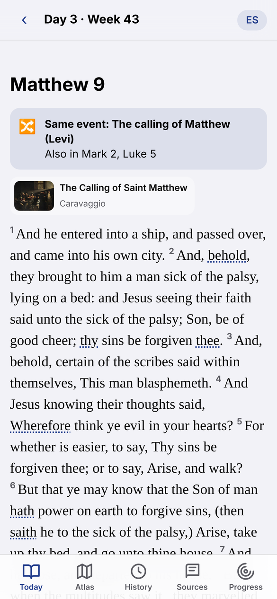
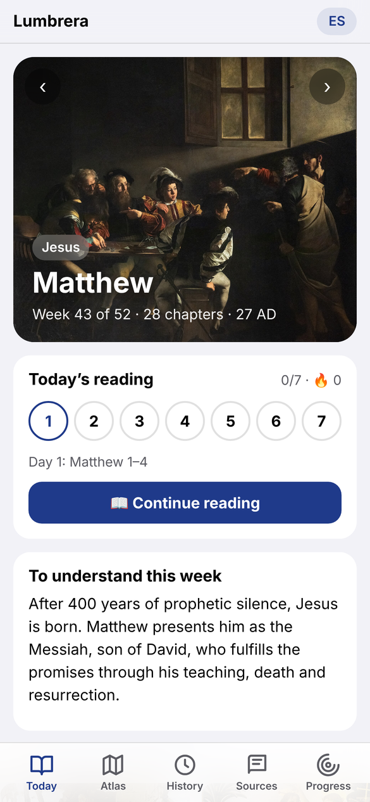

<p align="center">
  <a href="https://lumbrera.houseofmoy.us"></a>
</p>

<h3 align="center">
  <a href="https://lumbrera.houseofmoy.us/app/">📖 Start reading</a> &nbsp;·&nbsp;
  <a href="https://lumbrera.houseofmoy.us">Meet Lumbrera</a> &nbsp;·&nbsp;
  <a href="#️-support-the-iphone-and-android-apps">❤️ Support</a> &nbsp;·&nbsp;
  <a href="README.es.md">🇲🇽 Español</a>
</h3>

<p align="center">
  
  
  
  
</p>

> [!NOTE]
> **This is the web version** — free and ready today on any phone or computer. We're building advanced apps for **iPhone and Android** that will also be **free forever**. [See how to help ↓](#️-support-the-iphone-and-android-apps)

<br>

<table>
<tr>
<td width="42%" align="center"></td>
<td width="58%">

## A classic Bible.<br>A reading you can see.

> *Thy word is a lamp unto my feet, and a light unto my path.*<br>— Psalm 119:105, King James Version

**Lumbrera** — Spanish for that *light* — is the Bible in its classic editions, complete and unchanged: the **King James Version (1769)** in English and the **Reina-Valera (1909)** in Spanish. Both are public domain and are read exactly as they were published, without later revisions.

The text is never touched. What we add is **everything that helps you understand it**: where each event happened, who was who, what was going on in the world at the time, and what it looked like.

Many people understand better by **seeing** than by reading alone. Lumbrera is made for them.

</td>
</tr>
</table>

## By the numbers

| 📜 | 📅 | 📍 | 🎨 | 🎬 | 🔀 | 🔥 | 💲 |
|:-:|:-:|:-:|:-:|:-:|:-:|:-:|:-:|
| **2**<br>classic editions | **52**<br>weeks | **73**<br>places on the map | **60**<br>works of art | **24**<br>film scenes | **40**<br>parallel events | **14**<br>false gods | **$0**<br>forever |

## A better reading

You read the complete text, and the relevant information appears around it right when you need it.

<table>
<tr>
<td width="50%" valign="top">

### 🗓️ In the order it happened
The whole Bible in **52 weeks**, in chronological order: Job beside the patriarchs, the prophets beside the kings of their time, Paul's letters inside the story of Acts.

### 📝 Old words, explained
The English of 1769 and the Spanish of 1909 have words we no longer use — *thee*, *wist*, *publican*, *aqueste*. Tap them to see what they mean.

</td>
<td width="50%" valign="top">

### 🔀 Same event, several books
When an event is told more than once — the fall of Jerusalem, the Last Supper, Paul's conversion — it tells you where else it appears so you can compare.

### 🔎 Search everything
Every verse, person, place, false god, painting and film scene in one search box — or type *John 3:16* to jump straight there.

### 📜 Other writings of the time
Enoch, the Dead Sea Scrolls, Josephus, Gilgamesh and 36 more: what they are, how they relate to your reading, and why they are not part of the Bible.

</td>
</tr>
</table>

## For people who understand by seeing

<table>
<tr>
<td width="25%" align="center"><br><b>Where did it happen?</b></td>
<td width="25%" align="center"><br><b>Who was who?</b></td>
<td width="25%" align="center"><br><b>When did it happen?</b></td>
<td width="25%" align="center"><br><b>What did it look like?</b></td>
</tr>
<tr>
<td valign="top">A satellite map with every place and the country it's in today: Ur in Iraq, Edom in Jordan, Nineveh by Mosul.</td>
<td valign="top">From Adam to Jesus, with the line of the promise highlighted. Pan, zoom and open branches.</td>
<td valign="top">Kings, prophets and empires. Slide through time and see who ruled each year — and whether Kings calls him faithful.</td>
<td valign="top">Leonardo, Michelangelo, Caravaggio, Rembrandt: each work beside the passage it painted, with zoom.</td>
</tr>
<tr>
<td width="25%" align="center"><br><b>And in motion?</b></td>
<td width="25%" align="center"><br><b>Who did they worship?</b></td>
<td width="25%" align="center"><br><b>All beside the text</b></td>
<td width="25%" align="center"><br><b>Today's reading</b></td>
</tr>
<tr>
<td valign="top">Scenes from <i>Cabiria</i> (1914), <i>The Ten Commandments</i> (1923) and <i>The King of Kings</i> (1927), at the exact moment.</td>
<td valign="top">baal, molech, asherah, chemosh, dagon and more: what they were, where they were worshiped, what the Bible says.</td>
<td valign="top">Every chapter shows its art, its scenes and its parallels while you read.</td>
<td valign="top">Seven readings a week, with your progress and your streak.</td>
</tr>
</table>

## The one-year plan

| Era | Weeks | What you read |
|---|:-:|---|
| 🌍 Creation and fall | 1 | Genesis 1–11 and Job |
| ⛺ Patriarchs | 2–4 | Abraham, Isaac, Jacob and Joseph |
| 🔥 Exodus and wilderness | 5–11 | From Egypt to Sinai and the Jordan |
| ⚔️ Conquest and judges | 12–14 | Joshua, Judges and Ruth |
| 👑 United kingdom | 15–26 | Saul, David and Solomon, with Psalms and Proverbs |
| 🏛️ Divided kingdom | 27–37 | The kings of Israel and Judah, with their prophets |
| 🏺 Exile and return | 38–42 | Babylon, Persia and the rebuilding |
| ✝️ Jesus | 43–46 | The four Gospels |
| 🕊️ The church | 47–52 | Acts, the letters and Revelation |

## 📲 Put it on your phone

No app store, no account, nothing to pay.

| iPhone · iPad | Android | Computer |
|---|---|---|
| Open [Lumbrera](https://lumbrera.houseofmoy.us/app/) in **Safari** → **Share** → **Add to Home Screen** | Open it in **Chrome** → **⋮** menu → **Install app** | Open it in your browser |

Your progress stays on your device, and anything you've opened works offline.

## ❤️ Support the iPhone and Android apps

This web version is free and will stay free. We're already building the **advanced apps**, with what only a native app can do:

- ✈️ **Everything offline** from day one: scenes, art and maps
- 🗺️ **3D tours** of each week's places
- 🔔 **Reminders**, widgets and Siri
- 💬 **Explanations** of words and passages on the phone itself

**They will always be free — no ads, no in-app purchases.** To publish them we need to cover:

| | Cost |
|---|---|
| Apple App Store | $99 per year |
| Google Play | $25 once |
| Development time | donations |
| **Price for readers** | **$0, forever** |

**[I want to help →](https://github.com/moy418/biblia/issues/new?title=I%20want%20to%20support%20Lumbrera)** · Part of a church or ministry? Get in touch: a nonprofit can publish the apps without Apple's fee. Sharing Lumbrera with someone who could use it helps too.

## Sources

| Content | Source | License |
|---|---|---|
| Bible text | King James Version (1769) · Spanish: Reina-Valera (1909) | Public domain (the KJV remains under Crown patent in the UK) |
| Artworks | Wikimedia Commons | Public domain; photos of sculptures credit their photographer |
| Films | Internet Archive | Public domain |
| Maps | Esri World Imagery | With attribution |
| Articles | Wikipedia | CC BY-SA |

Dates are approximate. Art and films are their creators' interpretations — that's why each one comes with its passage, so you can compare it with what the Bible says.

<details>
<summary><b>For developers</b></summary>

A static site (plain HTML, CSS and JavaScript, plus [Leaflet](https://leafletjs.com) for the map). No server, no database.

```
index.html                         landing page
app/index.html, app.css, app.js    the app
app/sw.js, manifest.webmanifest    offline mode and install
app/data/                          content (en/es) and Bible text by book
app/img, app/clips, app/vendor     icons, scenes and Leaflet
docs/                              images for this page
```

To try it: run `python3 -m http.server` at the root and open `http://localhost:8000`. It deploys to Cloudflare Pages on every push to `main`.
</details>
