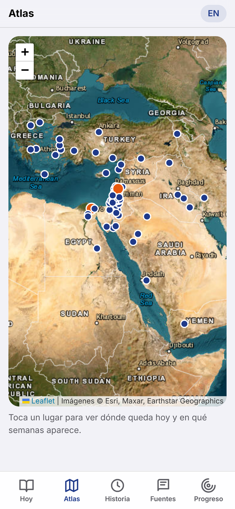

<p align="center">
  <a href="https://biblia-7s8.pages.dev"></a>
</p>

<h3 align="center">
  <a href="https://biblia-7s8.pages.dev/app/">📖 Empezar a leer</a> &nbsp;·&nbsp;
  <a href="https://biblia-7s8.pages.dev">Conocer Lumbrera</a> &nbsp;·&nbsp;
  <a href="#️-apoya-las-apps-para-iphone-y-android">❤️ Apoyar</a> &nbsp;·&nbsp;
  <a href="#english">English</a>
</h3>

<p align="center">
  
  
  
  
</p>

> [!NOTE]
> **Esta es la versión web**, gratuita y lista hoy en cualquier teléfono o computadora. Estamos construyendo las apps avanzadas para **iPhone y Android**, que también serán **siempre gratuitas**. [Ver cómo apoyar ↓](#️-apoya-las-apps-para-iphone-y-android)

<br>

<table>
<tr>
<td width="42%" align="center"></td>
<td width="58%">

## Una Biblia clásica.<br>Una lectura que se puede ver.

> *Lámpara es á mis pies tu palabra, y lumbrera á mi camino.*<br>— Salmos 119:105, Reina-Valera 1909

**Lumbrera** es la Biblia **Reina-Valera de 1909**, completa y sin cambios: una edición clásica en español, de dominio público, que se lee tal como fue publicada, sin revisiones posteriores.

El texto no se toca. Lo que agregamos es **todo lo que ayuda a entenderlo**: dónde pasó cada cosa, quién era quién, qué ocurría en el mundo en esos años y cómo se veía.

Muchas personas entienden mejor **viendo** que solo leyendo. Lumbrera está hecha para ellas.

</td>
</tr>
</table>

## En números

| 📜 | 📅 | 📍 | 🎨 | 🎬 | 🔀 | 🔥 | 💲 |
|:-:|:-:|:-:|:-:|:-:|:-:|:-:|:-:|
| **1909**<br>edición clásica | **52**<br>semanas | **73**<br>lugares en el mapa | **60**<br>obras de arte | **24**<br>escenas de cine | **40**<br>eventos paralelos | **14**<br>dioses falsos | **$0**<br>siempre |

## Una lectura mejorada

Lees el texto completo y, alrededor, aparece la información pertinente justo cuando la necesitas.

<table>
<tr>
<td width="50%" valign="top">

### 🗓️ En el orden en que pasó
La Biblia completa en **52 semanas**, en orden cronológico: Job junto a los patriarcas, los profetas junto a los reyes de su tiempo, las cartas de Pablo dentro de la historia de Hechos.

### 📝 Palabras antiguas, explicadas
El español de 1909 tiene palabras que ya no usamos. Tócalas y te dice qué significan.

</td>
<td width="50%" valign="top">

### 🔀 Mismo evento, varios libros
Cuando un hecho se cuenta más de una vez —la caída de Jerusalén, la última cena, la conversión de Pablo— te avisa dónde más aparece para comparar.

### 📜 Otros escritos de la época
Enoc, los Rollos del Mar Muerto, Josefo, Gilgamesh y 36 más: qué son, cómo se relacionan con tu lectura y por qué no forman parte de la Biblia.

</td>
</tr>
</table>

## Para quienes entienden mejor viendo

<table>
<tr>
<td width="25%" align="center"><br><b>¿Dónde pasó?</b></td>
<td width="25%" align="center"><br><b>¿Quién era quién?</b></td>
<td width="25%" align="center"><br><b>¿Cuándo pasó?</b></td>
<td width="25%" align="center"><br><b>¿Cómo se veía?</b></td>
</tr>
<tr>
<td valign="top">Mapa satelital con cada lugar y el país donde queda hoy: Ur en Irak, Edom en Jordania, Nínive junto a Mosul.</td>
<td valign="top">De Adán a Jesús, con la línea de la promesa resaltada. Se mueve, se amplía y abre ramas.</td>
<td valign="top">Reyes, profetas e imperios. Desliza y ve quién gobernaba cada año, y si fue fiel según Reyes.</td>
<td valign="top">Leonardo, Miguel Ángel, Caravaggio, Rembrandt: cada obra junto al pasaje que pintó, con zoom.</td>
</tr>
<tr>
<td width="25%" align="center"><br><b>¿Y en movimiento?</b></td>
<td width="25%" align="center"><br><b>¿A quién adoraban?</b></td>
<td width="25%" align="center"><br><b>Todo junto al texto</b></td>
<td width="25%" align="center"><br><b>Tu lectura de hoy</b></td>
</tr>
<tr>
<td valign="top">Escenas de <i>Cabiria</i> (1914), <i>Los Diez Mandamientos</i> (1923) y <i>El Rey de reyes</i> (1927), en el momento exacto.</td>
<td valign="top">baal, moloc, asera, quemós, dagón y más: qué eran, dónde se adoraban y qué dice la Biblia.</td>
<td valign="top">Cada capítulo muestra su arte, sus escenas y sus paralelos mientras lees.</td>
<td valign="top">Siete lecturas por semana, con tu avance y tu racha de días.</td>
</tr>
</table>

## El plan de un año

| Etapa | Semanas | Lo que lees |
|---|:-:|---|
| 🌍 Creación y caída | 1 | Génesis 1–11 y Job |
| ⛺ Patriarcas | 2–4 | Abraham, Isaac, Jacob y José |
| 🔥 Éxodo y desierto | 5–11 | De Egipto al Sinaí y al Jordán |
| ⚔️ Conquista y jueces | 12–14 | Josué, Jueces y Rut |
| 👑 Reino unido | 15–26 | Saúl, David y Salomón, con los Salmos y Proverbios |
| 🏛️ Reino dividido | 27–37 | Los reyes de Israel y Judá, con sus profetas |
| 🏺 Exilio y regreso | 38–42 | Babilonia, Persia y la reconstrucción |
| ✝️ Jesús | 43–46 | Los cuatro evangelios |
| 🕊️ La iglesia | 47–52 | Hechos, las cartas y Apocalipsis |

## 📲 Cómo tenerla en tu teléfono

No necesitas tienda de apps, cuenta ni pagar nada.

| iPhone · iPad | Android | Computadora |
|---|---|---|
| Abre [Lumbrera](https://biblia-7s8.pages.dev/app/) en **Safari** → **Compartir** → **Agregar a pantalla de inicio** | Ábrela en **Chrome** → menú **⋮** → **Instalar app** | Ábrela en tu navegador |

Tu progreso se guarda solo en tu dispositivo, y lo que ya abriste funciona sin internet.

## ❤️ Apoya las apps para iPhone y Android

Esta versión web es gratuita y lo seguirá siendo. Ya estamos construyendo las **apps avanzadas**, con lo que solo una app nativa permite:

- ✈️ **Todo sin internet** desde el primer día: escenas, arte y mapas
- 🗺️ **Recorridos en 3D** por los lugares de cada semana
- 🔔 **Recordatorios**, widgets y Siri
- 💬 **Explicaciones** de palabras y pasajes en el propio teléfono

**Serán siempre gratuitas, sin anuncios y sin compras dentro de la app.** Para publicarlas necesitamos cubrir:

| | Costo |
|---|---|
| App Store de Apple | $99 al año |
| Google Play | $25 una vez |
| Tiempo de desarrollo | donaciones |
| **Precio para quien lee** | **$0, siempre** |

**[Quiero apoyar →](https://github.com/moy418/biblia/issues/new?title=Quiero%20apoyar%20a%20Lumbrera)** · ¿Eres parte de una iglesia o ministerio? Escríbenos: una organización sin fines de lucro puede publicar las apps sin la cuota de Apple. Compartir Lumbrera con alguien que la pueda usar también ayuda.

## Fuentes

| Contenido | Fuente | Licencia |
|---|---|---|
| Texto bíblico | Reina-Valera 1909 · inglés: Berean Standard Bible | Dominio público |
| Obras de arte | Wikimedia Commons | Dominio público; las fotos de esculturas llevan el crédito de su fotógrafo |
| Películas | Internet Archive | Dominio público |
| Mapas | Esri World Imagery | Con atribución |
| Artículos | Wikipedia | CC BY-SA |

Las fechas son aproximadas. El arte y las películas son interpretaciones de sus autores; por eso cada uno lleva su pasaje, para compararlo con lo que dice la Biblia.

<details>
<summary><b>Para desarrolladores</b></summary>

Sitio estático (HTML, CSS y JavaScript sin compilar, más [Leaflet](https://leafletjs.com) para el mapa). Sin servidor ni base de datos.

```
index.html                         página de presentación
app/index.html, app.css, app.js    la app
app/sw.js, manifest.webmanifest    modo sin internet e instalación
app/data/                          contenido (es/en) y texto bíblico por libro
app/img, app/clips, app/vendor     íconos, escenas y Leaflet
docs/                              imágenes de esta página
```

Para probarla: `python3 -m http.server` en la raíz y abre `http://localhost:8000`. Se publica sola en Cloudflare Pages con cada cambio a `main`.
</details>

---

## English

<p align="center"><b>A classic Bible. A reading you can see.</b></p>

**Lumbrera** ("lamp", from Psalm 119:105) is the complete **1909 Reina-Valera** Spanish Bible, read exactly as published, without later revisions. The English version uses the public-domain Berean Standard Bible.

Around the untouched text it adds what helps you understand it: where each event happened and what country it is today, family trees, a timeline of kings and prophets, the false gods of neighboring peoples, classic paintings and silent-film scenes of each passage. It's made for people who understand better by seeing.

Free, no ads, no account. **[Start reading →](https://biblia-7s8.pages.dev/app/)**

**This is the web version.** Advanced iPhone and Android apps are in development and will always be free. We're looking for donations to cover app-store fees and development — **[get in touch](https://github.com/moy418/biblia/issues/new?title=I%20want%20to%20support%20Lumbrera)**.
