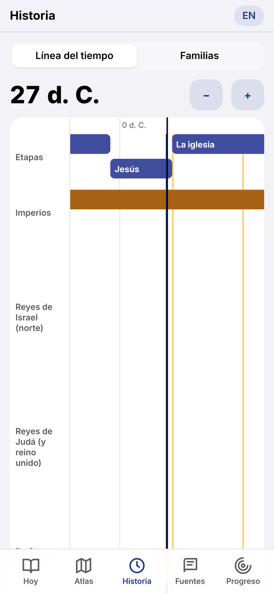
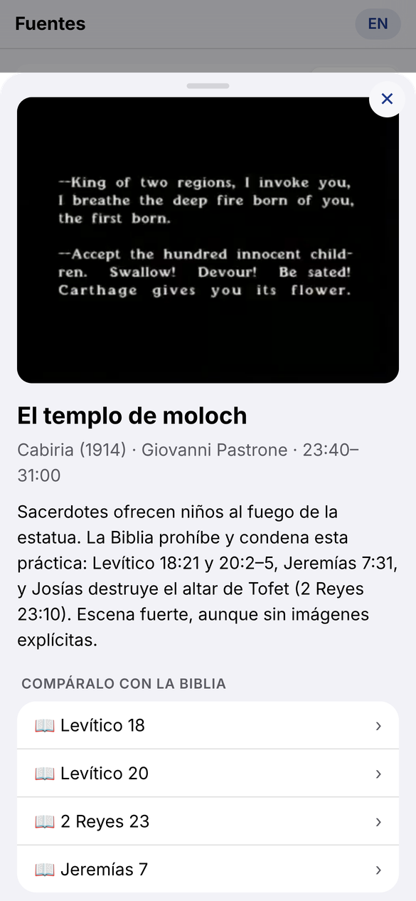

<p align="center">
  <a href="https://biblia-7s8.pages.dev"></a>
</p>

<p align="center">
  <a href="https://biblia-7s8.pages.dev"><b>Empezar a leer →</b></a> ·
  <a href="#cómo-tenerla-en-tu-teléfono">Tenerla en tu teléfono</a> ·
  <a href="#english">English</a>
</p>

---

## La idea

**Una Biblia clásica, con una lectura mejorada.**

Elegimos la **Reina-Valera de 1909**: una edición clásica en español, de dominio público, que se lee tal como fue publicada, sin las revisiones posteriores. El texto no se toca.

Lo que sí agregamos es todo lo que ayuda a entenderlo: dónde ocurrió cada cosa, quién era quién, qué pasaba en el mundo en esos años y cómo se veía. Muchas personas entienden mejor **viendo** que solo leyendo; esta Biblia está hecha para ellas.

## Una lectura mejorada

Lees el texto completo, y alrededor de él aparece la información pertinente justo cuando la necesitas:

- **En orden cronológico.** La Biblia completa en 52 semanas, en el orden en que ocurrieron los hechos: Job junto a los patriarcas, los profetas junto a los reyes de su tiempo.
- **Palabras antiguas explicadas.** El español de 1909 tiene palabras que ya no usamos; tócalas y te dice qué significan.
- **Mismo evento, varios libros.** Cuando un hecho aparece en más de un libro (la caída de Jerusalén, la última cena, la conversión de Pablo), te avisa dónde más se cuenta para que compares.
- **Contexto de cada semana.** Un resumen breve de lo que vas a leer y por qué importa.
- **Otros escritos de la época.** Enoc, los Rollos del Mar Muerto, Josefo y más, con su relación con tu lectura y por qué no forman parte de la Biblia.

## Para quienes entienden mejor viendo

<table>
<tr>
<td width="25%"></td>
<td width="25%"></td>
<td width="25%"></td>
<td width="25%"></td>
</tr>
<tr>
<td valign="top"><b>Dónde pasó</b><br>Un mapa satelital con cada lugar y el país donde queda hoy: Ur está en Irak, Edom en Jordania.</td>
<td valign="top"><b>Quién es quién</b><br>Un árbol genealógico de Adán a Jesús, con la línea de la promesa resaltada.</td>
<td valign="top"><b>Cuándo pasó</b><br>Reyes, profetas e imperios en una línea del tiempo: desliza y ve quién gobernaba ese año.</td>
<td valign="top"><b>Cómo se veía</b><br>60 obras clásicas —Leonardo, Miguel Ángel, Caravaggio, Rembrandt— junto al pasaje que pintaron.</td>
</tr>
<tr>
<td width="25%"></td>
<td width="25%"></td>
<td width="25%"></td>
<td width="25%"></td>
</tr>
<tr>
<td valign="top"><b>En movimiento</b><br>20 escenas de cine mudo clásico, como <i>Cabiria</i> (1914) y <i>El Rey de reyes</i> (1927), ligadas a su pasaje.</td>
<td valign="top"><b>A quién adoraban</b><br>Los dioses falsos de los pueblos vecinos —baal, moloc, asera, quemós— y qué dice la Biblia de ellos.</td>
<td valign="top"><b>Todo junto al texto</b><br>Mientras lees, cada capítulo muestra su arte, sus escenas y sus paralelos.</td>
<td valign="top"><b>Tu lectura de hoy</b><br>Siete lecturas por semana, con tu avance y tu racha de días.</td>
</tr>
</table>

## Cómo tenerla en tu teléfono

Es gratis, sin anuncios y sin crear cuenta. No necesitas tienda de apps:

- **iPhone o iPad:** abre [biblia-7s8.pages.dev](https://biblia-7s8.pages.dev) en Safari → **Compartir** → **Agregar a pantalla de inicio**.
- **Android:** ábrela en Chrome → menú **⋮** → **Instalar app**.
- **Computadora:** ábrela en el navegador.

Tu progreso se guarda solo en tu teléfono, y lo que ya abriste funciona sin internet.

## Fuentes

| Contenido | Fuente | Licencia |
|---|---|---|
| Texto bíblico | Reina-Valera 1909 (inglés: Berean Standard Bible) | Dominio público |
| Obras de arte | Wikimedia Commons | Dominio público; las fotos de esculturas llevan el crédito de su fotógrafo |
| Películas | Internet Archive | Dominio público |
| Mapas | Esri World Imagery | Con atribución |
| Artículos | Wikipedia | CC BY-SA |

Las fechas son aproximadas. El arte y las películas son interpretaciones de sus autores y pueden añadir detalles que no están en el texto; para eso cada uno lleva su pasaje, para compararlo con lo que dice la Biblia.

<details>
<summary><b>Para desarrolladores</b></summary>

Sitio estático (HTML, CSS y JavaScript sin compilar, más [Leaflet](https://leafletjs.com) para el mapa). No hay servidor ni base de datos.

```
index.html, app.css, app.js   la app
sw.js, manifest.webmanifest   modo sin internet e instalación
data/                         contenido (es/en) y texto bíblico por libro
img/  clips/  vendor/         íconos, escenas y Leaflet
```

Para probarla: `python3 -m http.server` dentro de la carpeta y abre `http://localhost:8000`. Se publica sola en Cloudflare Pages con cada cambio a `main`.
</details>

---

## English

**A classic Bible, with a reading you can see.**

The Spanish text is the **1909 Reina-Valera**, a classic public-domain edition read exactly as published, without later revisions. The English version uses the public-domain Berean Standard Bible.

Around the untouched text, the app adds what helps you understand it — where each event happened and what country it is today, family trees, a timeline of kings and prophets, the false gods of neighboring peoples, classic paintings and silent-film scenes of each passage. It's made for people who understand better by seeing.

Free, no ads, no account. **[Start reading →](https://biblia-7s8.pages.dev)** — on iPhone: Safari → Share → *Add to Home Screen*.
